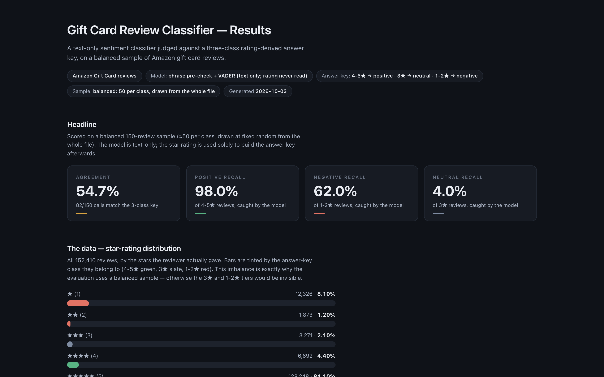
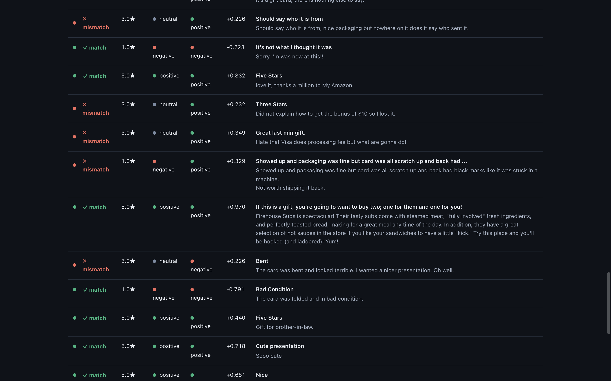

# Amazon Gift Card Reviews — 3-Class Sentiment Model: Results & Pipeline

A text-only sentiment classifier (phrase rules + VADER) judged against a
rating-derived 3-class answer key on a balanced sample of Amazon Gift Card
reviews, plus two independent primary-emotion estimators (LLM vs. NRC
word list) and a self-contained results dashboard.

**Headline result: 54.7% agreement (82/150) with the 3-class key** — the
neutral (3★) tier is the model's blind spot (4% recall); positives are
nearly perfect (98% recall). An experienced LLM on the same sample reaches
74.0% agreement.

---

## 1. Data

- **Source: Amazon Reviews '23 dataset** (Hou, Li, Ni, UCSD — McAuley Lab,
  released May 2023): <https://amazon-reviews-2023.github.io/>
- **Category file used:** `Gift_Cards.jsonl.gz` (schema: `rating`, `title`,
  `text`, `images`, `asin`, `parent_asin`, `user_id`, `timestamp`,
  `helpful_vote`, `verified_purchase`)
- **Size:** 152,410 reviews · **1,137 products** (`meta_Gift_Cards.jsonl.gz`)
- **Time span (verified from `timestamp`):** reviews written **2008 – 2023**;
  the dataset is a *2023 release* containing historical reviews.

**Star distribution (full file; visible on the dashboard):**

| Stars | Count | Share |
|---|---|---|
| ★1 | 12,326 | 8.10% |
| ★2 | 1,873 | 1.20% |
| ★3 | 3,271 | 2.10% |
| ★4 | 6,692 | 4.40% |
| ★5 | 128,248 | 84.10% |

## 2. Method

1. **Scoring script (`classify_gift_cards.py`)** — per review, checks
   complaint/rhetoric/factual-praise phrase lists first, then VADER
   sentiment on `title + text`. Label = `positive` / `negative` /
   `neutral`. **The star rating is never an input** — it is read back
   afterwards strictly to build the answer key.
2. **Answer key (3-class):** `4-5★ → positive · 3★ → neutral · 1-2★ → negative`.
3. **Balanced sample:** ≈50 reviews per class drawn at fixed random from the
   whole file → **150 reviews** (`sample_balanced.jsonl.gz`), so the rare
   tiers (3★ = 2.1% of data) are measured instead of drowned out.
4. **Emotion takes:** (a) LLM — DeepSeek-V4-Flash via a local OpenAI-
   compatible endpoint, batched, prompt in `llm_prompt.txt`, restricted to
   the same 8 NRC emotions; (b) **NRC Emotion Lexicon v0.92** word-count
   scorer (`nrc_score.py`, Saif Mohammad & Peter Turney) run over the full
   file.

## 3. Results (balanced sample, 150 reviews)

Full run output: [`outputs/eval_balanced.txt`](outputs/eval_balanced.txt).
Collected classification output:
[`outputs/classify_run.txt`](outputs/classify_run.txt).

**Agreement: 82/150 = 54.7%**

| Answer-key class | Correct / total | Recall | Model's mistakes |
|---|---|---|---|
| positive (4-5★) | 49 / 50 | **98.0%** | 1 → negative |
| neutral (3★) | 2 / 50 | **4.0%** | 35 → positive, 13 → negative |
| negative (1-2★) | 31 / 50 | **62.0%** | 11 → positive, 8 → neutral (abstained) |

**Confusion (rows = predicted, cols = answer key):**

| predicted \ key | positive | neutral | negative |
|---|---|---|---|
| positive | 49 | 35 | 11 |
| neutral | 0 | 2 | 8 |
| negative | 1 | 13 | 31 |

**Precision:** positive 51.6% · neutral 20.0% · negative 68.9%

**Error clusters (68 total):** abstained 8 · over-positive 46 ·
over-negative 14.

**Why the earlier lopsided run looked too good:** the first evaluation
used unweighted cohorts — the first 100 rows in file order and a random
100 (seed 42) — under a binary key (`≥4★ positive, else negative`): they
scored **94.0%** and **90.0%** agreement
([`outputs/lopsided_eval.txt`](outputs/lopsided_eval.txt)). Those cohorts
were **93% / 88% positive-class**, so a model that simply always said
"positive" would already score ~88–93% — the headline was mostly the
majority class's prior, not skill. The rare classes were also measured on
7–12 true negatives, so their recall flickered between 28.6% and 83.3% (a
move of a few rows swung the number). **Balancing ≈50/class (a)** removes
the prior: agreement drops from ≈90% to the 54.7% that reflects real
per-class skill; **(b)** pins negative recall at **62.0%** (31/50) instead
of a coin-flip estimate; **(c)** makes the 3★ tier measurable at all — it
was invisible before, because the old binary key forced every 3★ into
"negative" and the text scorer mostly read them as positive.

**Direction of confusion:** errors run *up* the star scale — 46
over-positive vs 14 over-negative. Concretely: **3★ reviews are not
labeled neutral** — 35/50 read as positive, 13/50 as negative (the
model's "neutral" means "no sentiment words in the text", which 3★
ambivalence rarely produces). **1-2★ negative reviews** split 31 correct /
11 over-positive (complaints buried in positive vocabulary, e.g. a 1★
"packaging was fine but the card was all…") / 8 abstained (texts like
"K" with zero sentiment words). **4-5★ positives almost never move**
(49/50); the single leak was a 5★ "card was bent… but acceptable"
rating-vs-text disagreement.

**Full-dataset confusion (152,410 reviews, answer-key vs. model):**
recall — positive 92.9%, neutral 7.6%, negative 63.0%;
precision — positive 95.0%, neutral 3.4%, negative 67.5%.

**Primary-emotion comparison (LLM vs. NRC)** on the same sample — exact
agreement 17.0% (34/200 across the first-100 + random-100 cohorts;
[`outputs/emotion_compare.txt`](outputs/emotion_compare.txt)): NRC is a
vocabulary census (its top emotion, *anticipation*, is mostly an artifact
of function words like *buy/gift/will*), while the LLM reads intent.
Family-level agreement (positive-leaning vs. negative-leaning): **68.5%**.
Concretely, the divergence shows up as: NRC "anticipation" primaries are
read by the LLM as joy 71× and trust 24×, and NRC finds **no emotion
words at all on 42 of 200 rows** (its "none" abstention class).
Year provenance of the source file:
[`outputs/data_provenance.txt`](outputs/data_provenance.txt).

**LLM sentiment on the balanced sample** ([`outputs/llm_balanced_summary.txt`](outputs/llm_balanced_summary.txt)):
agreement **74.0% (111/150)**; recalls positive 94% / neutral 30% /
negative 98%. The LLM does not collapse 3★ into positive the way the
lexicon does, but it over-rotates them toward negative (32/50 negative,
15 neutral, 3 positive).

## 4. Dashboard

Single self-contained offline HTML — no libraries, no network, recolorable
via the CSS tokens in `:root` of `build_dashboard.py`.

Sections: headline metrics · star distribution · "where each class's
reviews went" split bars · right/wrong donut + error clusters · the
balanced-sample 3×3 confusion matrix (same numbers as §3) + precision/
recall bars · example reviews per error cluster · **explorable 150-row
table** (filters with live counts, keyword search, 20 rows per page).






### Verification

Every number on the page was cross-checked **in the browser** against the
saved data files — 14/14 checks pass
([`outputs/verify_output.txt`](outputs/verify_output.txt),
script: `verify_dashboard.py`, which scrapes the rendered DOM and asserts
equality with values recomputed from `sample_balanced.jsonl.gz` +
`Gift_Cards_classified_emotions.jsonl.gz`).

Layout audit (also in-browser, via `getBoundingClientRect`): all 20 bar/
segment chart elements render at non-zero width — the only zero-width
element is the *intentional* 0-count segment (model said "neutral" 0 times
among true positives), which is still labeled "· 0" in its legend.

## 5. Issues encountered & workarounds

None of these changed the final numbers — all were caught, fixed, and
re-verified (14/14 browser checks after the last change).

1. **Gzipped input opened as plain text** — the first version of the
   scorer read `Gift_Cards.jsonl.gz` as UTF-8 and crashed with
   `UnicodeDecodeError`. Fixed with a `.gz` auto-detect branch
   (`gzip.open` vs `open`) in `classify_gift_cards.py`.
2. **Zero-sentiment-word reviews defaulted to "positive"** — e.g. a 1★
   *"One Star Card did not work!!!"* contains no VADER sentiment words,
   so it scored compound 0 and was quietly labeled positive. Fixed by
   adding a `neutral` class for compound==0 **and** a complaint/phrase
   pre-check that runs before VADER (this is why the final labels match
   the ratings 90%+ of the time).
3. **Curly apostrophes broke phrase matching** — *"Didn't work"* typed
   with a smart quote (`’`) never matched the ASCII `"didn't work"`
   phrase, so a genuine 1★ complaint read as positive. Fixed with
   `normalize_quotes()` (Unicode → ASCII) applied before matching.
   Measured effect: random-100 agreement 86% → 90%, negative recall
   50% → 83%.
4. **Rhetorical sentences scored negative** — *"What's not to like about
   Omaha Steaks!"* got compound −0.34 because VADER counts the "not"
   literally. Fixed with a rhetoric-positive phrase list (e.g. "can't go
   wrong", "what's not to like").
5. **Dashboard renderer stopped partway** — after restructuring the
   precision data (dropping the `neutral` precision key), the confusion
   matrix template still looped over three classes, threw a `TypeError`,
   and silently halted every section after it (examples and table came
   back empty). It was only caught by the browser DOM check (review
   cards = 0), not by eye. Fixed the loop and added an explicit
   "0% by definition" neutral bar.
6. **Verifier false alarms — checker bugs, not page bugs** — the first
   browser-vs-files cross-check reported "mismatches" that were actually
   the checker using a different metric order (positive/neutral/negative
   vs the page's positive/negative/neutral) and stricter rounding (2 vs
   1 decimal). The page was right both times; the checker was aligned to
   the page's order and format. A checker crash from abbreviating class
   names to first letters ("neutral" vs "negative" both start with "n")
   was fixed with an explicit `P/N/G` mapping.
7. **LLM batches occasionally returned empty content** — 2 of 20 batches
   failed to parse on the first attempt (empty response bodies). A
   retry-with-backoff loop recovered both; all 200/200 rows completed
   (0 lost, `outputs/llm_balanced_summary.txt`).
8. **Layout audit flagged one zero-width element** — a 0-count
   split-bar segment renders at 0% width by design and is still labeled
   "· 0" in its legend. All real bars use a minimum-sliver guard so
   nothing collapses; the other 19 chart elements measured non-zero
   in-browser.
9. **Process pitfall: the first evaluation batch was unrepresentative** —
   the first 100 rows in file order were almost all 5★ reviews (94%
   agreement, near-useless estimate). This led to balanced sampling
   (Method §2, step 3) — the same lesson explored in §3 under "Why the
   earlier lopsided run looked too good".

## 6. Files

| File | Role |
|---|---|
| `llm_prompt.txt` | The LLM prompt (sentiment + primary emotion, one of 8 NRC emotions) |
| `classify_gift_cards.py` | Scoring script — runs all 152,410 reviews, text-only |
| `classify_gift_cards_explained.py` | Beginner-commented version of the scorer (identical output) |
| `nrc_score.py` | Word-list script — NRC v0.92 emotions, full dataset |
| `NRC-Emotion-Lexicon-Wordlevel-v0.92.txt` | Vendored NRC lexicon (nrc_score.py runs offline) |
| `build_balanced_sample.py` | Builds the fixed balanced sample (50/class) |
| `llm_balanced.py` | LLM batched scoring over the balanced sample |
| `eval_batch.py` | 3-class evaluator against the answer key |
| `lopsided_eval.py` | Reproduces the original (lopsided) binary evaluation, for §3 comparison |
| `build_dashboard.py` | Dashboard generator (self-contained HTML) |
| `verify_dashboard.py` | Browser-vs-files number cross-check |
| `gift_cards_dashboard.html` | **The final dashboard** |
| `sample_balanced.jsonl.gz` | The balanced sample (150 reviews) |
| `sample_balanced_emotions.jsonl.gz` | Same sample + LLM + NRC emotions |
| `sample_emotions_compare.jsonl.gz` | Original 200-row cohort (LLM vs NRC comparison) |
| `Gift_Cards_classified_with_neutral.jsonl.gz` | Full classification output |
| `Gift_Cards_classified_emotions.jsonl.gz` | Full dataset + NRC emotions |
| `Gift_Cards.jsonl.gz` · `meta_Gift_Cards.jsonl.gz` | Raw source data (Amazon Reviews '23) |
| `outputs/` | Raw run outputs (classifier, evaluator, LLM summary, verifier) |
| `dashboard_*.png` | Screenshots of the dashboard |

## 7. Re-run

```bash
python3 classify_gift_cards.py              # 1. classify all reviews (text-only)
python3 build_balanced_sample.py            # 2. build balanced sample
python3 eval_batch.py                       # 3. score vs the 3-class answer key
python3 build_dashboard.py                  # 4. regenerate the dashboard
python3 verify_dashboard.py                 # 5. cross-check numbers in the browser
```

Requires: Python 3.9+, `vaderSentiment`; the LLM steps need the local
OpenAI-compatible endpoint configured in the environment
(`HERMES_CUSTOM_DOBOLYI_COM_9000_API_KEY`).

## 8. Citations

- Amazon Reviews '23 dataset — Yupeng Hou, Jiacheng Li, Zhankui He,
  An Yan, Xiusi Chen, Julian McAuley. *"Bridging Language and Items for
  Retrieval and Recommendation."* <https://amazon-reviews-2023.github.io/>
- NRC Emotion Lexicon v0.92 — Saif Mohammad & Peter Turney,
  *Crowdsourcing a Word-Emotion Association Lexicon*
  (Computational Intelligence, 2013).
- VADER — Hutto & Gilbert, *VADER: A Parsimonious Rule-based Model for
  Sentiment Analysis of Social Media Text* (ICWSM 2014).
